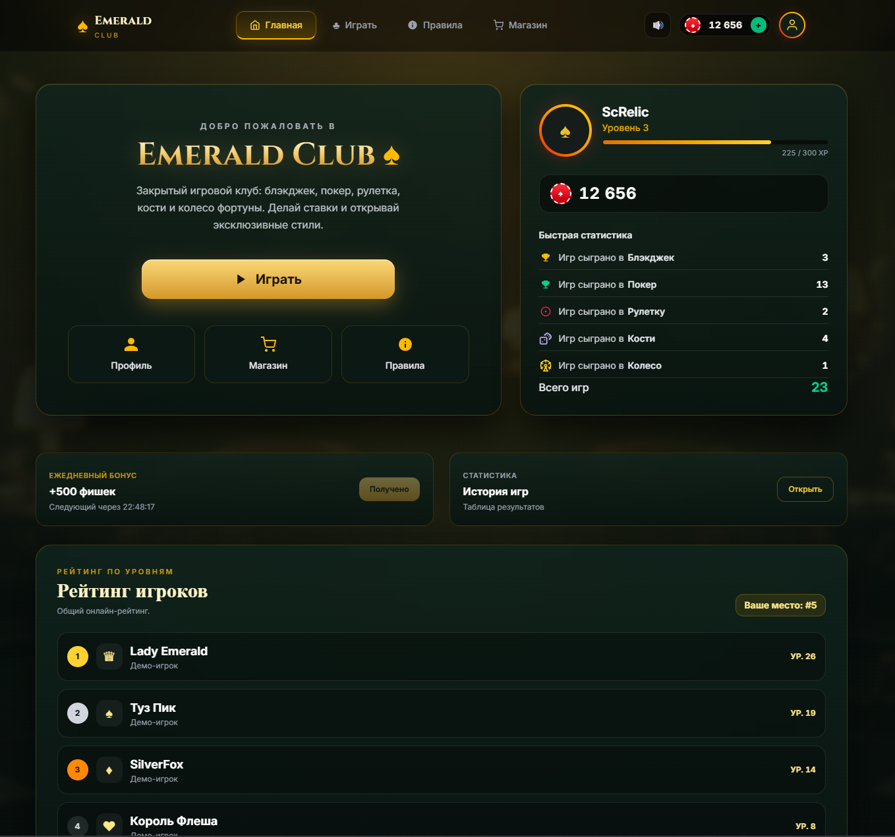
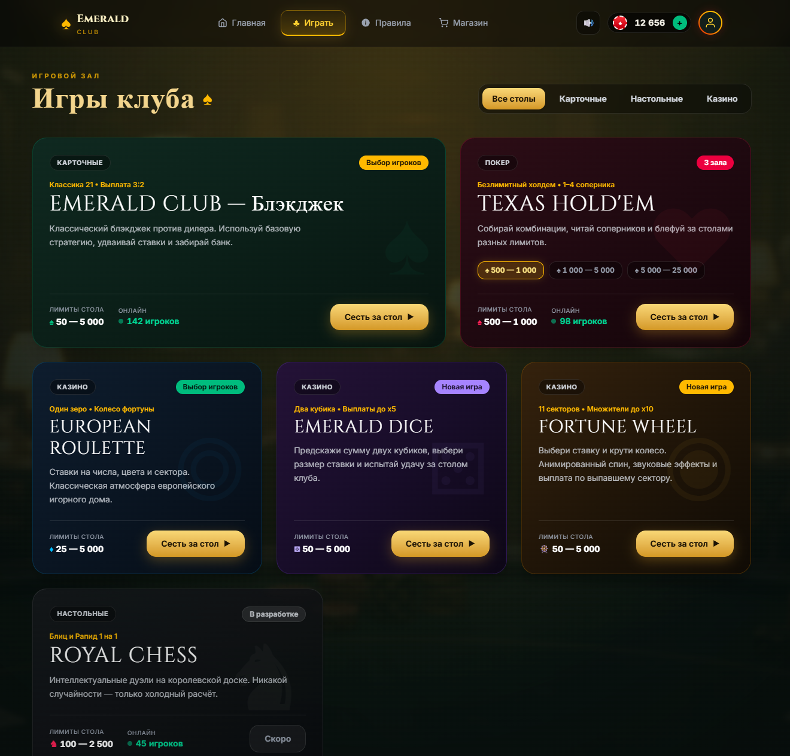
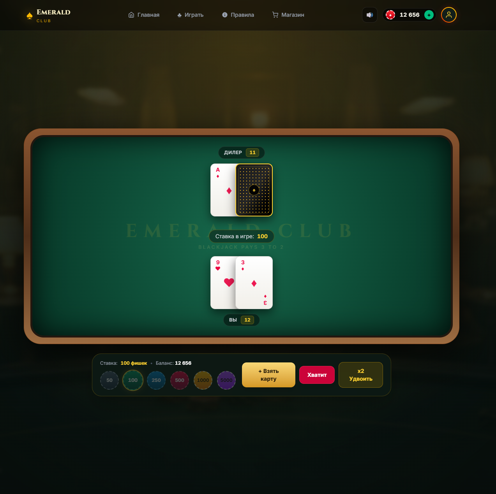
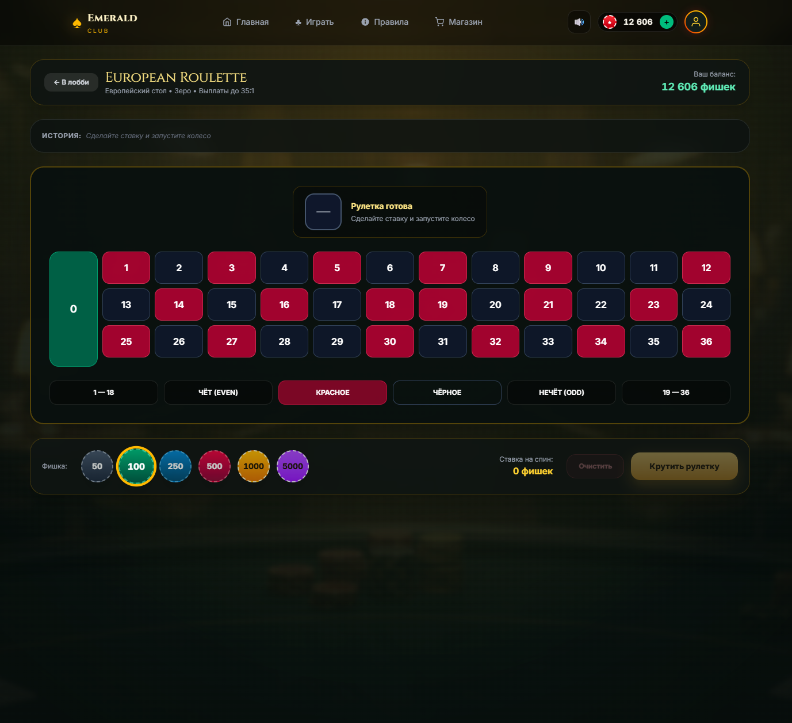
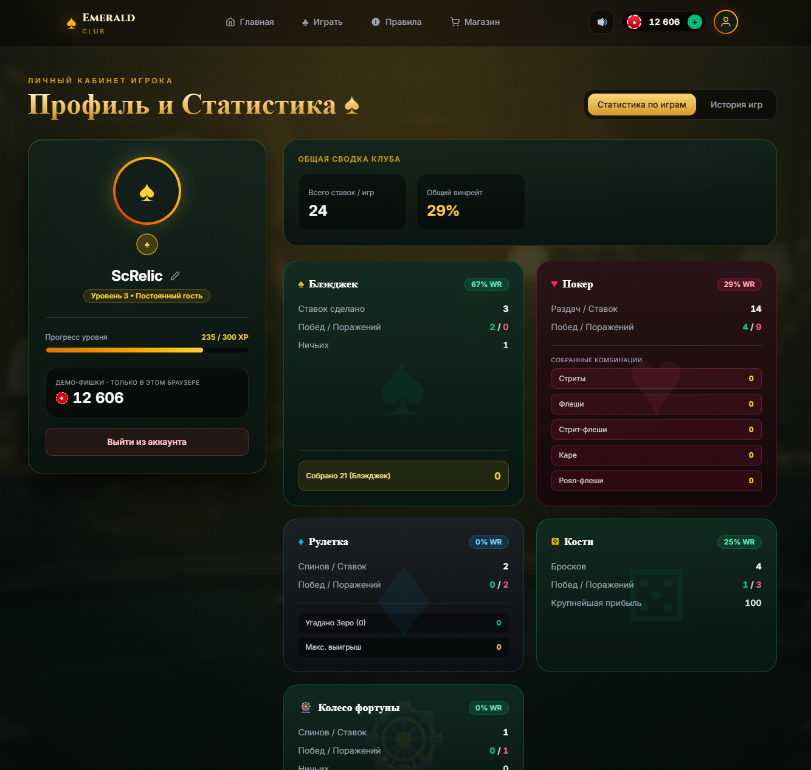
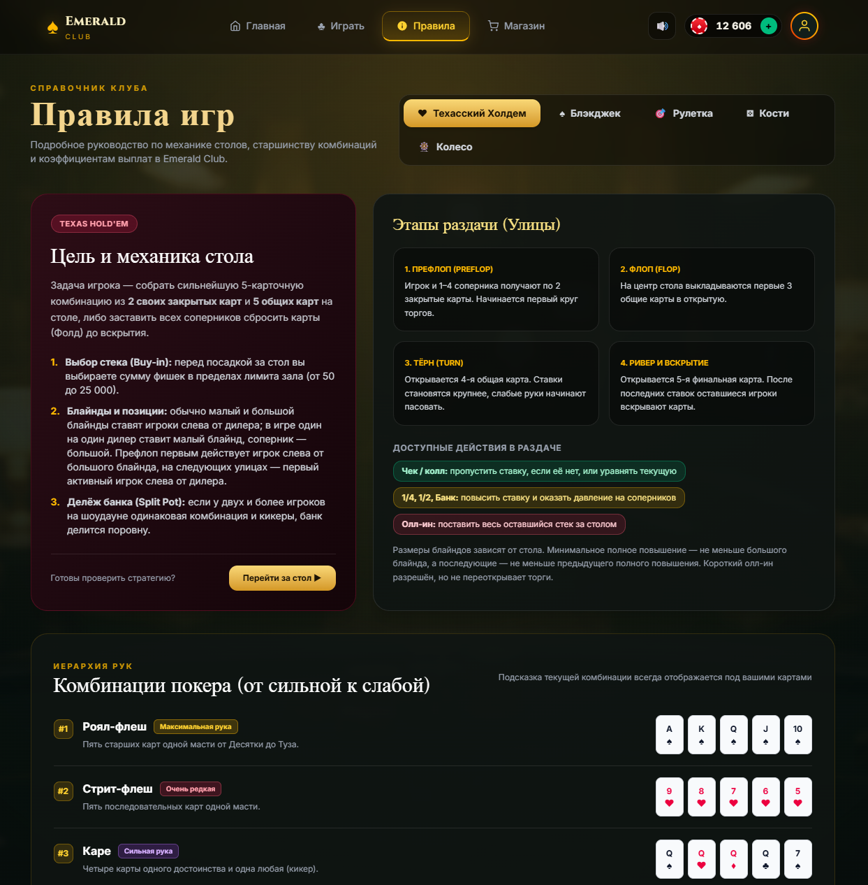
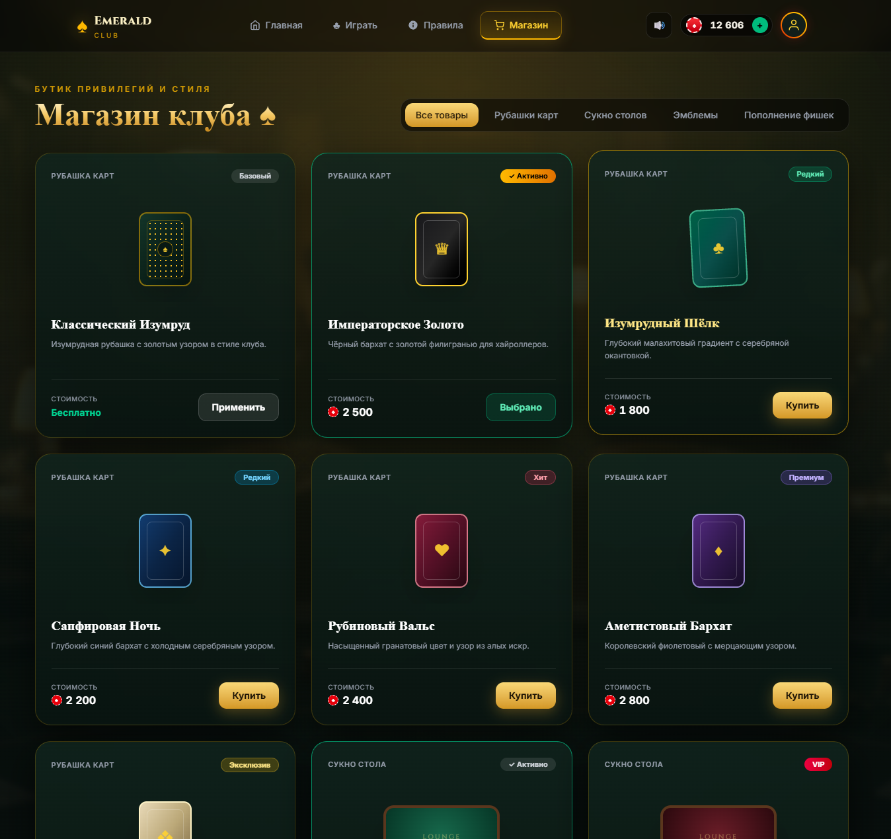

# ♠ Emerald Club

### Full-Stack Casino-Style Gaming Platform

Emerald Club is a personal full-stack pet project focused on building an interactive gaming platform with a modern frontend, REST API, persistent player progress, and server-side game logic.

**[🎮 Live Demo](https://emerald-club.vercel.app)** · **[💻 Source Code](https://github.com/scRelic/Emerald-Club)**

---

## ✨ Features

- 🎲 **Multiple Games** — Poker, Blackjack, Roulette, Dice, and Fortune
- 👤 **Authentication** — User registration and login
- 💰 **Virtual Currency** — Player balances and game progress
- 🃏 **Server-Side Logic** — Game mechanics and result calculations
- 🏆 **Player Progression** — Achievements and statistics
- 🎨 **Responsive Design** — Desktop, tablet, and mobile layouts
- 💾 **Persistent Storage** — PostgreSQL database integration

---

## 🛠️ Tech Stack

| Category | Technologies |
|---|---|
| **Frontend** | Vue 3, Vite, Pinia, Vue Router |
| **Styling** | Tailwind CSS |
| **Backend** | Node.js, Express.js, REST API |
| **Authentication** | Session-based authentication |
| **Database** | PostgreSQL |
| **Database Hosting** | Neon |
| **Frontend Hosting** | Vercel |
| **Backend Hosting** | Render |

---

## 📸 Screenshots

### 🏠 Homepage



### 🎮 Games



### 🃏 Blackjack



### 🎡 Roulette



### 👤 Profile



### 📜 Rules



### 🛍️ Shop



---

## 🏗️ Architecture

Emerald Club follows a client-server architecture, separating the user interface, business logic, and data persistence.

### Frontend

- Vue 3 for building interactive interfaces
- Pinia for application state management
- Vue Router for client-side navigation
- Tailwind CSS for responsive styling
- REST API integration for communication with the backend

### Backend

- Node.js and Express.js
- REST API endpoints
- Server-side game logic and calculations
- Authentication and session management
- Player balance and game session handling

### Database

- PostgreSQL for persistent data storage
- Player profiles and virtual balances
- Game sessions and player progress

### Deployment

| Service | Platform |
|---|---|
| Frontend | Vercel |
| Backend | Render |
| Database | Neon PostgreSQL |

---

## 🧠 Technical Challenges

### 🎲 Server-Side Game Logic

Implemented game mechanics on the backend to process game results without relying on client-side calculations.

### 🃏 Poker Session Management

Implemented persistent poker sessions, allowing players to restore their game state after refreshing the page.

### 🔐 Authentication

Implemented session-based authentication using cookies and backend authorization checks.

### 📱 Responsive UI

Designed responsive layouts for desktop, tablet, and mobile devices using Tailwind CSS.

---

## 🚀 Getting Started

### 1. Clone the Repository

```bash
git clone https://github.com/scRelic/Emerald-Club.git
cd Emerald-Club
```

### 2. Install Dependencies

**Frontend:**

```bash
npm install
```

**Backend:**

```bash
cd server
npm install
cd ..
```

### 3. Configure Environment Variables

Create the required environment files using the provided examples and configure the database connection and application settings.

### 4. Start the Development Servers

**Frontend — from the project root:**

```bash
npm run dev
```

**Backend — from the server directory:**

```bash
cd server
npm run dev
```

---

## 🧪 Testing

The project includes automated tests to help verify game mechanics and backend functionality.

**Testing areas:**

- Poker and Blackjack game logic
- Game rules and result calculations
- Backend API behavior
- Authentication and security
- Frontend state management

---

## 🚧 Roadmap

Planned improvements:

- [ ] Improve mobile responsiveness
- [ ] Expand automated test coverage
- [ ] Add GitHub Actions CI
- [ ] Improve game animations
- [ ] Optimize application performance
- [ ] Improve accessibility

---

## ⚠️ Disclaimer

Emerald Club is an educational pet project using virtual chips.

**No real-money gambling is supported.**

---

<p align="center">
  Built as a personal full-stack development project.
</p>
